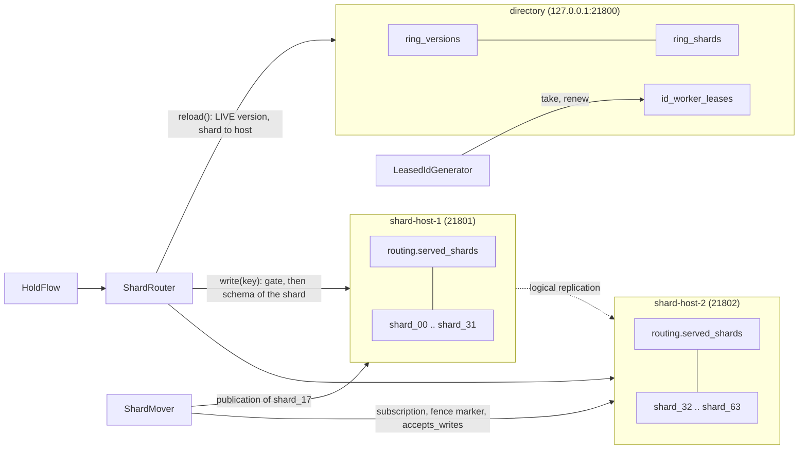

# Architecture

`seatwave-partitions` is Module 18's project: SeatWave's booking data split over 64 logical shards on a consistent-hash ring, the routing that finds a key's shard and machine, the ID generator that needs no central counter, and a measured move of one shard between two machines while it takes writes.

## Packages

| Package | What it owns | Needs |
|---|---|---|
| `ring` | `TokenHash` (key to 64-bit token, MD5), `HashRing` (immutable ring with virtual nodes), `KeyDistribution`, `RingSimulationCli` | the JDK |
| `shardkey` | `BookingWrite`, `CandidateKey` (the five candidate keys), `ShardKeyCli` | `ring` |
| `ids` | `IdLayout`, `SnowflakeIdGenerator`, `SteppedClock`, `IdGeneratorCli`; `WorkerLeases` and `LeasedIdGenerator` (the worker-id lease on `id_worker_leases`) | the JDK; JDBC for the lease |
| `config` | `SettingsReader`, `StackSettings` (every key checked once), `Databases` (pools and Flyway) | HikariCP, Flyway |
| `routing` | `ShardRouter`, `ShardAddress`, `ShardKeys`, `ShardWork`, `ShardPause`, `WriteRefusal`, `Constraints` | `ring`, `config`, JDBC |
| `holds` | `HoldFlow` (reserve, route, claim; confirm; find by id; my tickets), `Customers`, `HoldView` | `routing`, `ids` |
| `lab` | `LabCluster` (directory, two machines, 64 shard schemas, reset), `SectionKey` | `config`, `routing` |
| `move` | `ShardMover`, `CopyInProgress`, `MoveReport`, `ShardSeed`, `MoveWriter`, `WriterTally`, `MoveAudit`, `ShardMoveCli` | everything above |

## The dependency rule

`ring`, `shardkey` and the generator in `ids` depend on the JDK alone, so the module's central simulations run anywhere. Database code depends on them, never the other way. Only `*Cli` classes print or exit. Expected failures are `Result` values (`WriteRefusal`, `LeaseRefusal`); exceptions are for infrastructure faults and bugs.

## Data flow

## Walk-through: one hold

1. `HoldFlow.hold(customer, event, seat)` writes a reservation on the shard of `customer-<id>`. The trigger `reservation_limit_per_customer` locks the customer's row and counts unexpired reservations; at four it refuses. The customer's shard makes the hold id with `uuidv7()`.
2. It writes the route (`id_routes`) on the shard of the hold id's own text.
3. It writes the claim on the shard of `event-<id>/section-<code>`; `one_claim_per_seat` decides.
4. If the claim is refused, the reservation is deleted. If the process dies first, the reservation expires with the hold.

Every step goes through `ShardRouter.write`: it takes the shard's gate (shared), routes the key on the live ring, sets the connection's schema to the shard's, and commits or rolls back by the work's result. If the machine answers `write_to_owner_only`, the router returns `NotOwner`.

## Walk-through: a shard move

`ShardMover.copy` creates the target schema with `accepts_writes = false`, a publication of the shard's eleven tables on the old machine and a subscription on the new one, and waits until every table is ready. `ShardMover.finish` waits for a marker row to arrive (catch-up), then switches: the router's gate for the shard is taken exclusively (writes queue); the fence on the old machine locks the shard's tables in SHARE mode, sets `accepts_writes = false` and writes a marker, in one transaction; the move waits for that marker on the new machine (lag 0); the directory row is flipped, the new machine accepts writes, the router reloads, the gate is released. The subscription and publication are then dropped; the old copy stays, refusing writes.

## Decisions and trade-offs

- **One schema per shard, 32 per machine.** Logical shards are fixed (64), machines are few; a move copies one schema. The alternative, one database per shard, costs a connection pool per shard.
- **Ownership checked by the database.** A statement trigger on every shard table reads `routing.served_shards`. A stale router therefore gets an error instead of splitting a shard's data. It checks the machine owns the shard, not that the key belongs to the shard; a ring change (65 shards) would need a per-key check too.
- **The fence takes a table lock, not a row lock per write.** Writes pay nothing extra; the fence waits for writes in flight and blocks new ones until its commit. Its lock order follows the hold flow's table order, so a write in flight cannot deadlock with it.
- **Lag 0 is proven by a marker row**, not by comparing log positions: logical replication applies in commit order, so the marker's arrival proves every earlier write arrived.
- **Database time for expiry.** Holds, reservations and leases use the database's `now()`, so instances need not agree on time; a lease holder stops a tenth of the lease early by its own clock.
- **The move runs as the superuser** for the publication and subscription only (a publication of named tables needs their owner or a superuser; production would use a role made for moves).
- **Simplified:** no dual reads (step 3 of Section 6e), no reverse stream for rollback, `customer_ref` unique per shard only, and the "my tickets" listing written after the booking without an outbox (Module 28).

## Invariants and where they are enforced

| Invariant | Enforced by | Test |
|---|---|---|
| No two ids equal; ids from one worker increase | `SnowflakeIdGenerator.nextId` | `SnowflakeIdGeneratorTest` (a mutant that trusts the clock fails 2) |
| One live worker id per holder | `WorkerLeases` grant (`ON CONFLICT ... DO UPDATE ... WHERE expired`) | `WorkerLeaseStackTest.racingInstancesNeverShareAWorkerId` |
| An expired lease issues no id | `LeasedIdGenerator.nextId` | `LeasedIdGeneratorTest` |
| At most one live ring version | unique index `one_live_ring` | `ShardRouterStackTest.theDirectoryRefusesASecondLiveRingVersion` |
| At most four active holds per customer, across shards | trigger `reservation_limit_per_customer` (lock, count) | `HoldFlowStackTest.aCustomerGetsAtMostFourHolds...` |
| One claim per seat | Module 13's `one_claim_per_seat` on the seat's shard | `HoldFlowStackTest.oneSeatGoesToOneFan...` |
| One machine accepts a shard's writes | trigger `write_to_owner_only`; the fence's lock | `ShardMoveStackTest` (stale router refused; the fence waits for a write in flight) |
| A move loses and doubles no acknowledged write | the switch's order (pause, fence, marker, flip) | `ShardMoveStackTest.aShardMovesUnderWrites...` |
